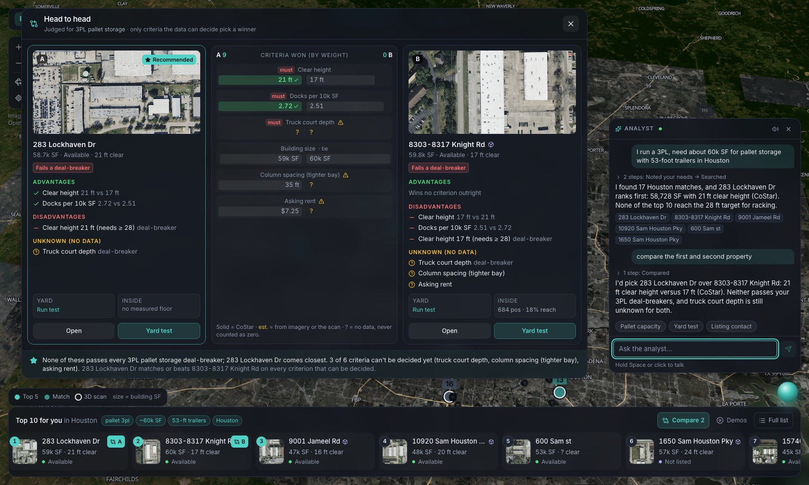
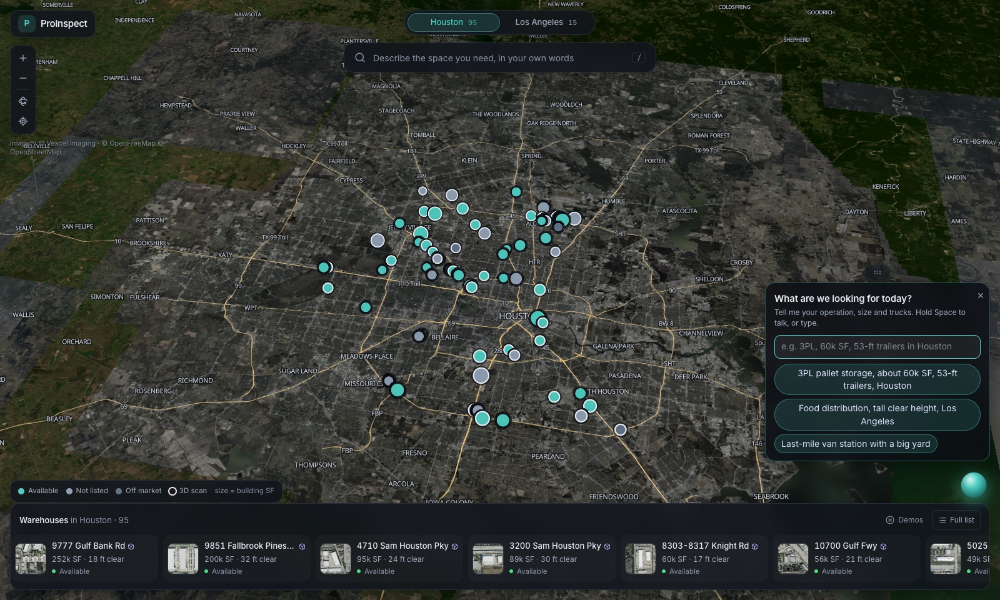
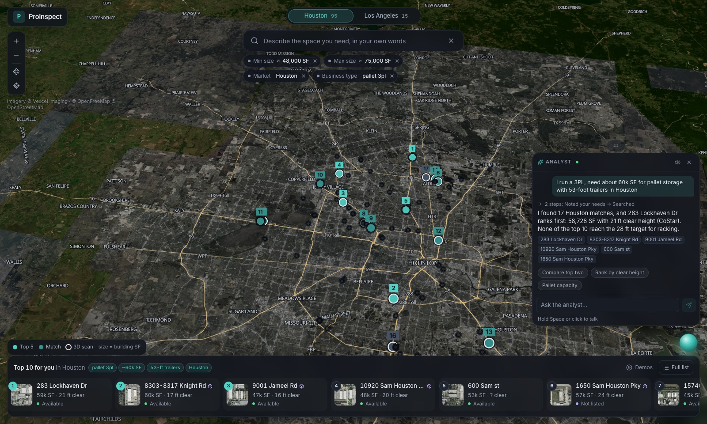
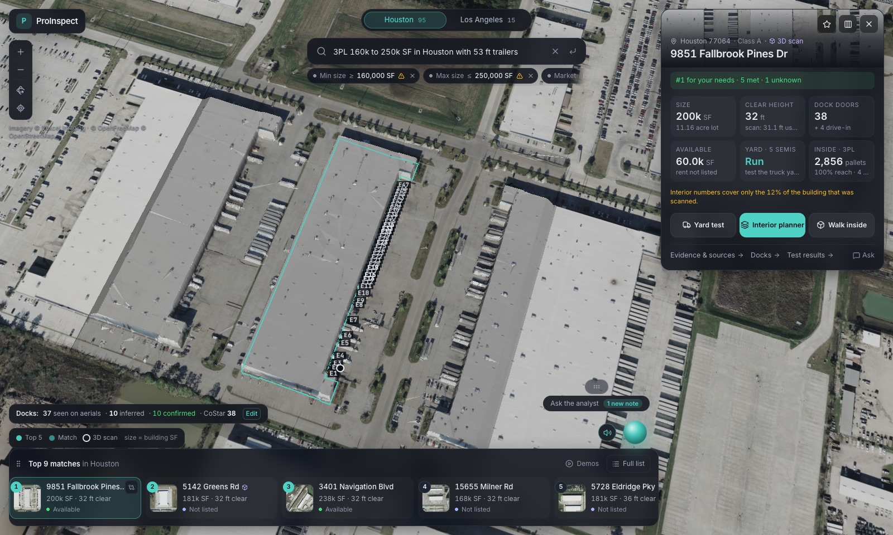
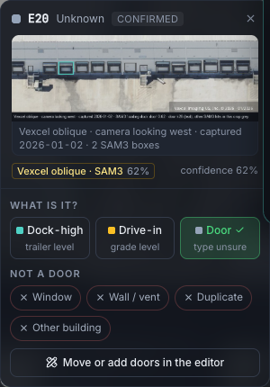
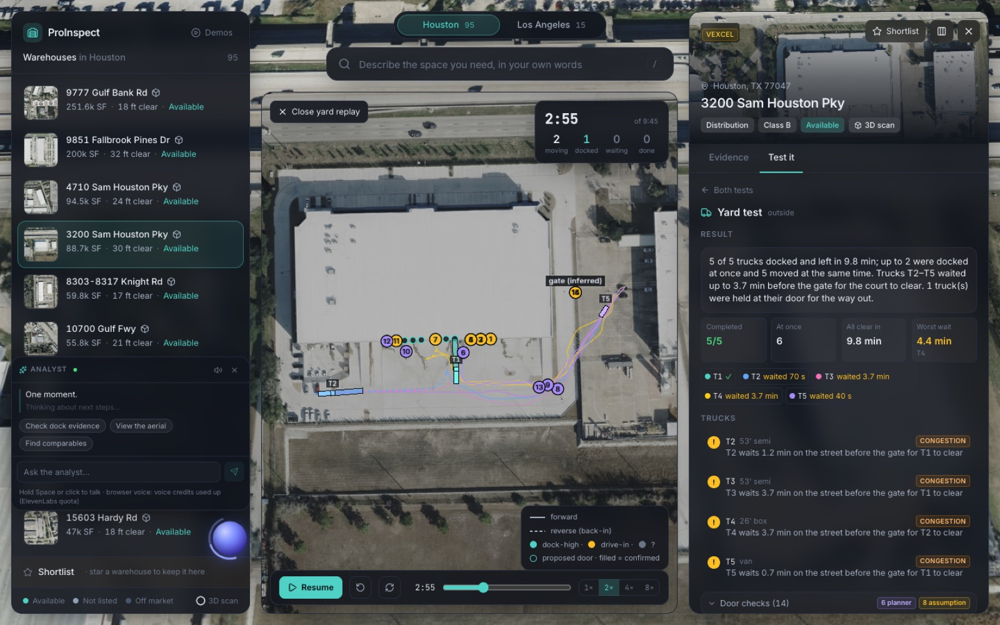
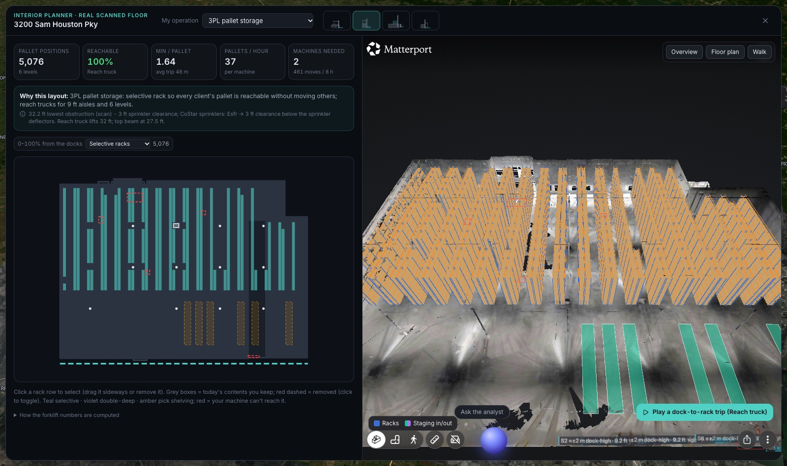
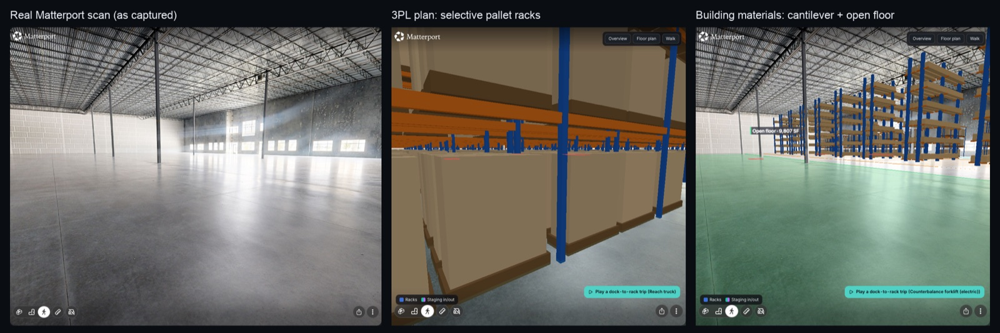
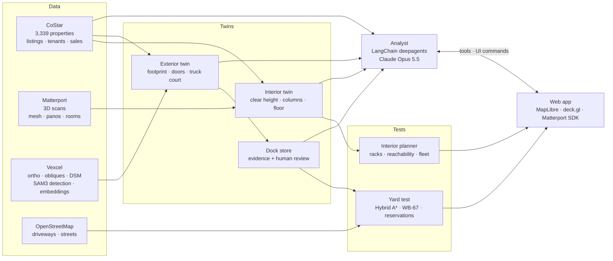

<div align="center">

# ProInspect

### Test-drive a warehouse before you buy it.

An AI analyst that finds warehouses for **your** operation, then proves whether they work:<br>
trucks in the yard, racks and forklifts inside the **real 3D scan**, side by side with the alternatives.




</div>

---

## The problem

A warehouse listing tells you square feet, clear height and a dock count. A buyer needs to know something else:

> **"Will my operation actually work in this building?"**

Can five 53-foot semis get in, back into the docks and leave without blocking each other? How many pallet positions
fit around *these* columns, under *this* sprinkler system, with *my* reach trucks? Today that takes site visits,
a broker, and a consultant with a CAD file. ProInspect answers it in minutes, from data CoStar already has.

## What it does

| | |
|---|---|
| 🗣️ **Talk to an analyst** | "3PL, about 60k SF, 53-ft trailers, Houston." It notes your needs, searches, and fills the strip with your **top 10**. Voice or text. |
| ⚖️ **Compare head to head** | "Compare the first and second." Two buildings side by side over the map, with advantages, disadvantages and unknowns judged for *your* operation. |
| 🚛 **Yard test** | Real trucks, kinematically planned, back into the real doors on the real parcel. Who waits, who can't turn, and why. |
| 🏗️ **Interior planner** | Racks laid out on the **scanned** floor around real columns and under real clearances. Then a forklift proves every slot is reachable. |
| 🚪 **Dock doors from the sky** | Doors detected on Vexcel oblique imagery, each with its photo proof, and you can categorize or correct every one. |
| 🧭 **Honest by design** | Every number is tagged: **verified** (CoStar), **estimated** (imagery or scan), or **unknown**. Unknown is never zero. |

---

## A walk through

### 1. Tell it what you need

The analyst greets you on load. Say or type your operation; it records only what you said, then searches.



### 2. Your top 10, curated

The strip shows the ten best buildings for your needs, with your profile as chips. Everything you ask updates it:
*"smallest warehouses"*, *"most loading docks"*, *"closest to a grocery store"*.



### 3. Open a property

One glance: size, clear height (CoStar **and** measured in the scan), docks, availability, yard grade, and storage
capacity. Dock doors are drawn on the building, and the analyst speaks up the first time you open a building.



<table>
<tr>
<td width="62%">

**Every door has proof.** Click a door to see the Vexcel oblique crop where SAM3 found it. Then categorize it
(**dock-high**, **drive-in**, or **door, type unsure**), or reject it with a reason (**window**, **wall / vent**,
**duplicate**, **other building**). Your call feeds the yard test: semis only use dock-high doors.

</td>
<td width="38%"></td>
</tr>
</table>

### 4. Test the yard (outside)

Semis, box trucks and vans arrive at a gate found from OpenStreetMap driveways and drive a Hybrid A* path on a
WB-67 tractor-trailer model. They back into the doors and pull out, coordinated by a space-time reservation table so
they don't collide. Failures are classified (**geometric**, **assumption**, **planner**, **congestion**), never
hand-waved.



### 5. Plan the inside (on the real scan)

Pick your operation and the layout follows. 3PL gets selective racks, cold storage gets double-deep, e-commerce
gets a shelving pick zone, building materials gets cantilever. Racks are placed on the scanned floor, around its
real columns, with levels set from the measured lowest obstruction minus the sprinkler clearance. A forklift then proves
reach %, minutes per pallet, pallets per hour and how many machines you need.





<p align="center"><sub>Same scan, same camera: as captured · 3PL selective racks · building materials (cantilever + open floor)</sub></p>

### 6. Decide

"Compare the first and second" puts both buildings side by side over the map. Criteria are chosen for your operation,
a winner is named only beyond each criterion's tolerance, deal-breakers are flagged, and unknowns are listed rather
than guessed. The recommendation comes from deterministic rules, not from the language model.

---

## How it works



**The language model never invents a number.** The analyst drives deterministic tools (rank, compare, comparables,
dock evidence, yard test, interior planner), and any figure it states that no tool returned is flagged as unverified.
Tests only start when *you* ask for one; that rule is enforced in code, not just in the prompt.

### What we measured, and how well

| Measurement | Method | Checked against CoStar |
|---|---|---|
| Clear height | Matterport mesh: roof deck, lowest obstruction P5 / P50 | 42 scans · MAE **2.3 ft** on held-out scans |
| Column bay spacing | Columns seen in both a low and a high slice of the mesh | 2 of 2 within **0.5 ft** |
| Dock doors | SAM3 on facade crops of 4 oblique directions + docked trailers | 39 sites · MAE 21.2 → **16.7**; treated as a **lower bound** |
| Drive-in door size | Pixels × GSD from the oblique camera model | MAE **2.3 ft** wide · **3.3 ft** tall |
| Truck turning | WB-67 off-axle hitch model | Outer radius **45.0 ft**; a semi needs ~120 ft of court |

Where a method is weak, the app says so: door counts are lower bounds, scans cover a median 22% of a building
(interior numbers say which area they cover), and a mismatched parcel suppresses the exterior facts.

---

## Quick start

**Requirements:** Python 3.12, Node 20+, and API keys for Anthropic, Vexcel and Matterport (ElevenLabs is optional,
for voice).

```bash
# 1. keys: create .env in the project root (never commit it)
ANTHROPIC_API_KEY=...
VEXCEL_API_KEY=...
MATTERPLOT_API_KEY=...      # Matterport Model API key (variable name kept from the kit)
MATTERPLOT_API_TOKEN=...
MATTERPLOT_SDK_KEY=...      # Showcase / Bundle SDK key, allowed on http://localhost:8080
ELEVEN_LABS_API_KEY=...     # optional: voice (falls back to the browser voice)

# 2. backend (FastAPI, port 8010)
uv venv --python 3.12 .venv && uv pip install --python .venv/bin/python -r backend/requirements.txt
#   (or: python3.12 -m venv .venv && .venv/bin/pip install -r backend/requirements.txt)
cd backend && ../.venv/bin/uvicorn proinspect.api:app --port 8010

# 3. web app (Vite + React 19, port 8080: the port the Matterport key allows)
cd web && npm install && npm run dev
```

Open **http://localhost:8080**, tell the analyst what you're looking for, and hold <kbd>Space</kbd> to talk.

<details>
<summary><b>Useful commands</b></summary>

```bash
cd backend && ../.venv/bin/python -m pytest -q tests     # 260 backend tests
cd web && npm run build                                   # type-check + production build
cd backend && ../.venv/bin/python -m proinspect.precompute  # rebuild hero runs after sim changes
```

Restarting the backend? Kill only the listener: `kill $(lsof -ti tcp:8010 -sTCP:LISTEN)`. A plain
`lsof -ti tcp:8010 | xargs kill` also kills the Vite dev server, which proxies to 8010.

</details>

<details>
<summary><b>Voice controls</b></summary>

| Action | How |
|---|---|
| Talk | Hold <kbd>Space</kbd>, or click the orb |
| Stop speaking | <kbd>Esc</kbd>, or the **Stop** button beside the orb (it stays quiet for 5 minutes after) |
| Voice off / on | The speaker button beside the orb (remembered) |
| When it speaks | Your questions, and the first time you open a building. Chips, buttons and test results answer in text. |

</details>

---

## Project layout

```
ProInspect/
├── backend/proinspect/
│   ├── agents/          guide.py: the deepagents analyst (tools, UI commands, guardrails)
│   ├── twin/            interior (Matterport mesh) and exterior (Vexcel) digital twins, fusion
│   ├── yard/            Hybrid A*, pure pursuit, reservations, OSM gates, the maneuver test
│   ├── interior.py      operation-driven rack layouts + forklift proofs
│   ├── docks.py         dock store: detections, evidence, human review, labels
│   ├── analytics.py     rank by attribute in tiers, compare, comparables
│   ├── voice/           ElevenLabs Scribe STT + Flash TTS, browser fallback
│   └── api*.py          FastAPI routes
├── web/src/
│   ├── components/      map, results strip, property panel, head-to-head compare
│   ├── matterport/      Bundle SDK stage: racks, forklifts and trucks inside the scan
│   ├── yard/ racks/ docks/   the two tests and the dock editor
│   └── voice/           the analyst orb and panel
├── data/  schemas/  models/   CoStar data kit (see index.md)
└── docs/                contracts, research memos, images
```

## Honest limits

- **Pallet flows only.** No each-picking, AMRs or conveyors yet.
- **Door detection is a lower bound.** It correlates poorly with CoStar's counts, so it never fails a building on its own.
- **The interior covers what was scanned.** Below 30% coverage, whole-building estimates are flagged unreliable and hidden.
- **The sample is CoStar's Matterport capture list,** not the whole market: 110 warehouses in Houston and Los Angeles.
- **Contact details in the kit are synthetic.** "Request a tour" logs the intent; nothing is sent.

## Built with

**CoStar** property data · **Matterport** Model API + Bundle SDK · **Vexcel** API 2.0 (ortho, oblique, DSM, SAM3,
embeddings) · **OpenStreetMap** Overpass · **Anthropic Claude** via LangChain deepagents · **ElevenLabs** ·
FastAPI · SimPy · NumPy · React 19 · Vite · Tailwind v4 · MapLibre · deck.gl · Zustand

<div align="center">
<sub>Built at HackPrinceton F26 for the CoStar challenge, <i>Inside and Out: AI for the Built World</i>.</sub>
</div>
